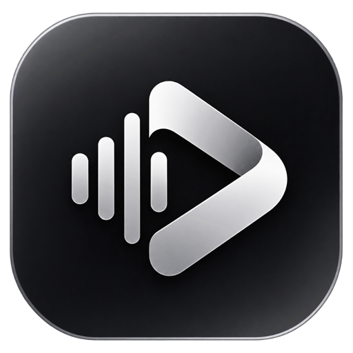

# VizMotion

**Desktop Music Player & Audio Visualizer Video Composer for Windows**

Create studio-grade music player videos inspired by **Apple iOS 18 / 26 Liquid Glass**, **visionOS Spatial Audio**, **HyperOS**, and **Spotify** — rendered at up to **4K 60fps** with hardware GPU acceleration.

---

### [⬇️ Download VizMotion (Beta) for Windows x64](https://github.com/ellanfvnky/vizmotion/releases/latest)

## ✨ Overview

**VizMotion** is a native Windows desktop studio built for music producers, DJs, remixers, and content creators who want clean, authentic, high-framerate music player visuals for **TikTok, Instagram Reels, YouTube Shorts, and YouTube 16:9** — without heavy After Effects project files or watermarks.

## 🎨 Built-In Visual Templates (8 Styles)

Every template automatically adapts to **Portrait (`9:16`)**, **Landscape (`16:9`)**, **Square (`1:1`)**, and **`4:5`** with isolated per-template settings:

| # | Template | Style & Highlights |
| :-: | :--- | :--- |
| 1 | **iOS 18 Liquid Glass Player** | Authentic Apple frosted-glass card, 6-bar reactive beat equalizer, marquee title, volume bar & customizable AirPlay pill. |
| 2 | **iOS 18 Lock Screen Player** | Full iPhone Lock Screen with Status Bar, real-time synced Clock & Date, Dynamic Island (Music / Lock mode), Squircle Artwork & Glass Now Playing HUD. |
| 3 | **iOS Quick Look Audio Player** | Pitch-black Apple Files Quick Look interface with refractive **iOS 26 Liquid Glass** center Play/Pause lens and dense scrolling waveform tape. |
| 4 | **iOS 13 / 14 Control Center Card** | Classic expanded Control Center dark-glass card with device subtitle, round-knob progress scrubber, and classic big-knob volume slider. |
| 5 | **HyperOS Media Control Card** | Modern Xiaomi HyperOS Control Center player with capsule volume bar and active Bluetooth device selector pill. |
| 6 | **Apple Studio Vinyl & Spectrum Dock** | Collector album sleeve with spinning physical vinyl disc peeking out, Studio Master 24-Bit badge, and 3-layer **Liquid Ribbon Wave** visualizer. |
| 7 | **visionOS Spatial Halo Turntable** | Open circular turntable disc with **72-bar 360° Radial Halo Spectrum**, Dolby Atmos badge, and visionOS glass console. |
| 8 | **Spotify Now Playing** | Authentic Spotify layout with automatic cover-extracted ambient color gradient, Liked Songs checkmark, Shuffle/Repeat icons, and Spotify Connect bar. |

## ⚡ Key Features

- **Hardware-Accelerated Video Export (up to 4K 60fps):** Automatic GPU encoder detection for **NVIDIA NVENC**, **Intel QuickSync (QSV)**, and **AMD AMF**, with reliable **x264 CPU** fallback. Bundled with FFmpeg & FFprobe — zero external setup required.
- **Smart Static-Base + Dirty-Patch Engine:** Renders unchanged background blur once and streams only animated regions, delivering multi-times realtime export speeds.
- **Animated Artwork & Video Backdrops:** Supports static images (`PNG`, `JPG`, `WEBP`), **animated GIFs** (auto-converted to crisp H.264 loop proxies), and **MP4 / MOV / WEBM** video backgrounds.
- **Audio Studio Controls:** Interactive Premiere-style timeline with draggable **Trim IN / OUT**, playback speed control, **Audio Gain (dB)**, **Linear / Exponential / Logarithmic / S-Curve** fade-in/out, anti-clipping limiter, and dedicated **Preview Monitor Volume**.
- **Customizable Output Device Icons:** Choose from **7 vector icons** (*AirPlay, AirPods, AirPods Max, iPhone, HomePod, Bluetooth, CarPlay*) across iOS & Spotify templates.
- **Project Files (`.vzm`) & Autosave:** Save/reopen `.vzm` projects anytime with crash-safe autosave recovery.
- **Built-In Auto-Updater & Bug Reporter:** Receive automatic notifications when new updates are published, and send bug reports or feature requests directly from inside the app.

## 💻 System Requirements

- **OS:** Windows 10 / Windows 11 (64-bit)
- **RAM:** 8 GB minimum (16 GB recommended for 4K 60fps export)
- **GPU (Optional):** NVIDIA GTX/RTX (NVENC), Intel iGPU (QSV), or AMD Radeon (AMF) for hardware-accelerated rendering
- **Storage:** ~500 MB free disk space

## 📥 Installation

1. Go to the **[Releases](https://github.com/ellanfvnky/vizmotion/releases)** page and download the latest `VizMotion-Setup-*-x64.exe`.
2. Run the installer and follow the setup wizard.
3. > **Note on Windows SmartScreen:** Because this Beta build is not yet signed with a commercial EV certificate, Windows Defender SmartScreen may display *"Windows protected your PC"*. Click **More info** → **Run anyway** to proceed safely.

## 🐞 Feedback & Bug Reports

Found a bug or have a template idea? Click the **Bug / Feedback** icon directly in the top bar of **VizMotion** to submit a report (with optional screenshot & system diagnostics), or open an issue in this repository.

---

  Created with ❤️ by <strong>Ellan Fvnky</strong> • Copyright © 2026 Ellan Fvnky. All rights reserved.

